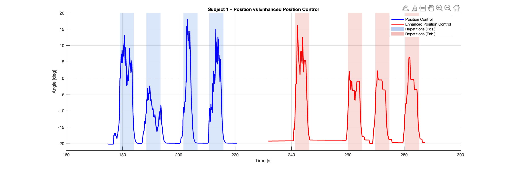

# Haptic interface: biceps EMG control of a 1-DoF haptic paddle

Course project at EPFL (spring 2026). C firmware for a one degree-of-freedom haptic paddle running on an STM32F407 microcontroller, built on the EPFL-REHAssist course skeleton.

The course starts with three lab sessions (TP1 to TP3: sensing, PID position control, virtual walls and compensation), then ends with a project called `labspec`. In `labspec`, the biceps muscle activity is measured with a sensor, processed on the microcontroller, and used to drive the paddle through a PID controller. Experiments compare a plain position control with an "enhanced" position control.

*Paddle angle during four repetitions with each control mode (subject 1), plotted from the experiment logs.*

## What is in this repository

- **Firmware** (`src/`): control loop in `src/haptic_controller.c` at 1 kHz. It reads the incremental encoder, the Hall sensor and the biceps sensor (ADC), then:
  - estimates paddle velocity and acceleration (with low-pass filters);
  - filters the biceps signal (band-pass, RMS, normalisation);
  - runs a PID position controller with torque saturation;
  - applies friction and gravity compensation;
  - exposes its variables to the PC interface for live tuning.
- **MATLAB** (`MATLAB/`): the PC interface (`hri_gui.m`, `hri_comm.m`), log loading (`hri_load_logfile.m`) and the plots of the experiments (`plot_S1.png`, `plot_S2.png`, `box_plot.png`).
- **Data**: experiment logs in `Experiment_log/` and `MATLAB/logs/`, lab session logs in `log/`, figures from the PID design in `images_haptic/`.
- **Lab sessions** (`travaux-pratiques/`): the controller of each of the first three labs, as it was at the end of the lab.

## Lab sessions

| Lab | Topic | Folder |
| --- | --- | --- |
| TP1 | Getting started: Hall sensor, encoder, paddle angle | [travaux-pratiques/TP1](travaux-pratiques/TP1) |
| TP2 | Paddle model (MATLAB/Simulink) and PID position control | [travaux-pratiques/TP2](travaux-pratiques/TP2) |
| TP3 | Virtual walls, friction and gravity compensation, K-B plots | [travaux-pratiques/TP3](travaux-pratiques/TP3) |

Each folder has its own README.

## Hardware

- STM32F407 microcontroller (STM32F407G-DISC1 board description in `STM32F407G-DISC1.xml`)
- EPFL REHAssist board with the 1-DoF haptic paddle (motor, incremental encoder, Hall sensor)
- Biceps EMG sensor read on an ADC channel

## Build

No Makefile is provided. The project is an Eclipse-based STM32 project (System Workbench for STM32): import the repository as an existing project (the settings are in `.cproject` and `.project`), with the `arm-none-eabi` GCC toolchain. The linker script is `LinkerScript.ld` and the startup code is in `startup/`. The ST libraries (CMSIS and StdPeriph driver) are included in the repository.

Note: this README was written without access to the toolchain, so the build was not re-run for this version.

## Documentation

The generated Doxygen documentation (`doc/html`) is no longer versioned. To regenerate it, install [Doxygen](https://www.doxygen.nl/) and run `doxygen Doxyfile` from the repository root. `doc/firmware_documentation.html` and `doc/graphics/` are kept.

## Team

- Tim Kobler
- Claudie-gd (teammate): contributed the step-response analysis script `tp2_4.m` (used in TP2) and added the experiment plots and MATLAB tools to the repository.

## License

This repository is distributed under the [Apache License 2.0](LICENSE), the same license as the EPFL-REHAssist (Rehabilitation and Assistive Robotics Group) course skeleton it is built on. Keep the license headers of the source files when reusing the code.
